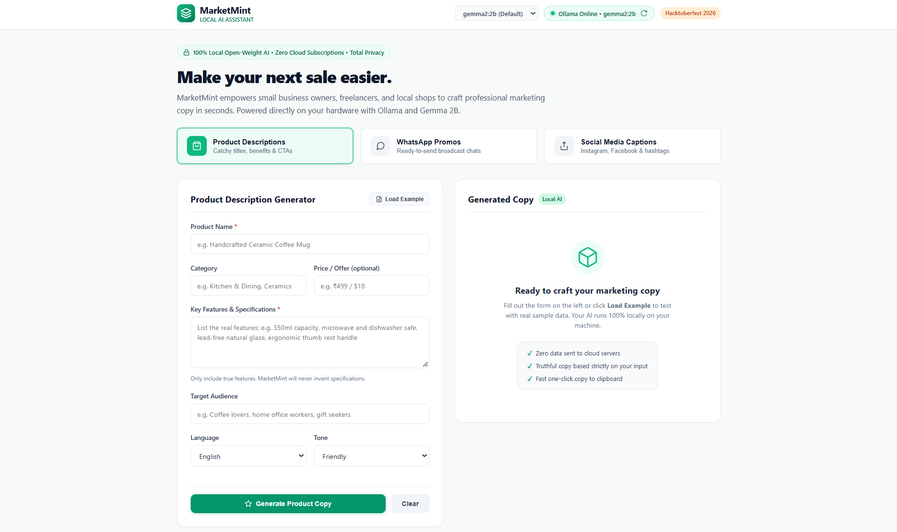
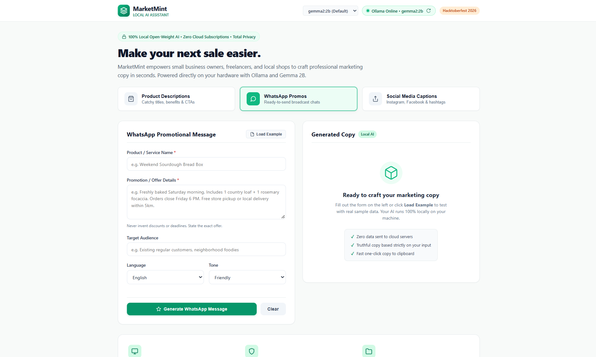
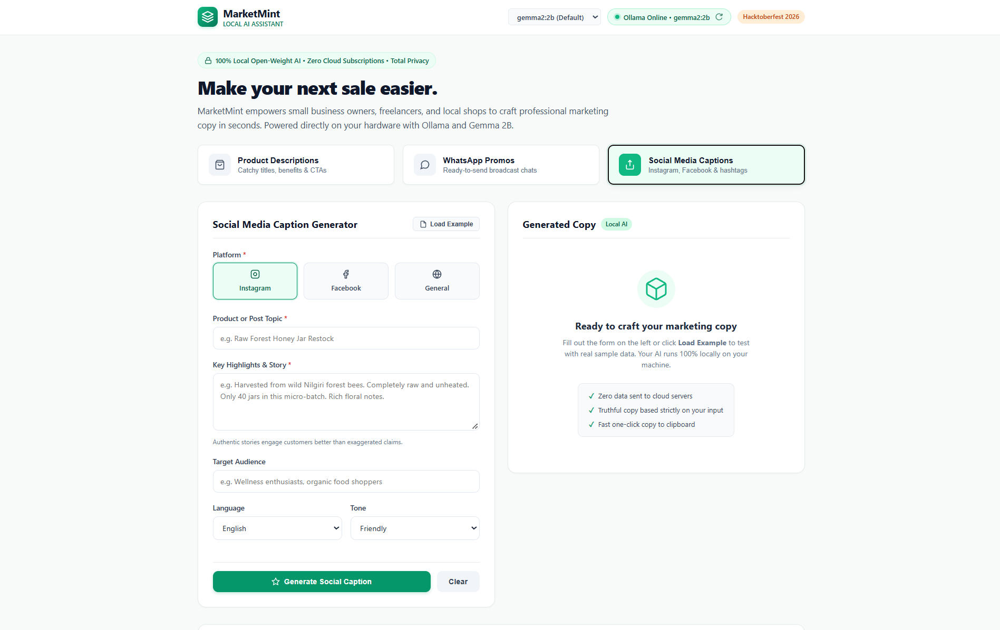

# MarketMint 🌱 — Local AI Marketing Assistant

> **Hacktoberfest 2026 Week 2 Challenge: "Side Hustle"**  
> Empowering small business owners, freelancers, artisans, and online sellers with 100% private, local open-weight AI marketing copy — zero subscriptions, zero API keys, and zero cloud tracking.

---

## 📸 Screenshots



*The MarketMint dashboard with real-time Ollama connectivity status, model selector, and generator tabs.*



*WhatsApp promotional message generator with authentic product benefits, clear CTAs, and mobile-friendly formatting.*



*Social media caption generator with platform-tailored hooks for Instagram, Facebook, and general feeds.*

---

## ✨ Problem & Features

Small business owners and side hustlers often struggle to write persuasive marketing copy for their products, WhatsApp groups, and social feeds. Paid cloud AI tools charge recurring monthly subscriptions, require API keys, and upload proprietary product ideas and customer communication to external servers.

**MarketMint solves this with 100% on-device open-weight AI (Ollama + Gemma 2B):**

- **📦 Product Descriptions:** Catchy headlines, engaging narrative descriptions, 3–5 bulleted selling points, and a clear Call to Action.
- **💬 WhatsApp Promotions:** Ready-to-send broadcast messages with friendly openings, authentic benefits, and restrained emoji usage.
- **📸 Social Media Captions:** Tailored for Instagram (punchy hooks & clean spacing), Facebook (conversational storytelling), and General feeds with 5–8 curated hashtags.
- **🎯 Zero Hallucinations:** Enforced system prompt prevents inventing fake discounts, certifications, or imaginary specifications.
- **🌐 Multilingual & Tone Controls:** English, Hindi (हिन्दी), Telugu (తెలుగు), and Tamil (தமிழ்) across 5 tones (Friendly, Professional, Playful, Persuasive, Minimal).
- **📋 Copy & Edit:** One-click clipboard copy with visual feedback, in-app editable view toggle, and word/character counters.
- **🔒 Complete Privacy:** No telemetry, no cloud APIs, and zero data leaving your computer.

---

## 🧰 Tech Stack

- **Frontend:** HTML5, CSS3 (Mint Green SaaS design system), vanilla JavaScript (ES6+).
- **Backend:** Python 3.10+ with [Flask](https://flask.palletsprojects.com/).
- **AI Engine:** [Ollama](https://ollama.com/) running Google's open-weight **Gemma 2B (`gemma2:2b`)**.
- **HTTP Client:** Python `requests`.
- **Security:** AI responses rendered strictly with safe DOM nodes (`textContent`) — never raw `innerHTML`.

---

## 🚀 Windows Quick Start

### 1. Install Prerequisites
1. **Python 3.10+**: Download from [python.org](https://www.python.org/downloads/) (check **"Add python.exe to PATH"**).
2. **Ollama**: Download from [ollama.com/download](https://ollama.com/download).

### 2. Download the Model
In PowerShell or Command Prompt, run:
```powershell
ollama pull gemma2:2b
```

### 3. Setup Virtual Environment & Install Dependencies
In the `MarketMint` folder:
```powershell
python -m venv venv
.\venv\Scripts\Activate.ps1
pip install -r requirements.txt
```

### 4. Start MarketMint
```powershell
python app.py
```
Open **`http://localhost:5000`** in your browser. The status pill will display **Ollama Online • gemma2:2b**.

---

## 📁 Repository Structure

```
MarketMint/
├── .env.example               # Configuration template (ports, host, model, timeouts)
├── .gitignore                 # Ignores venv/, __pycache__/, and temporary files
├── app.py                     # Flask server & Ollama chat integration
├── requirements.txt           # Minimal dependencies (Flask, requests, python-dotenv)
├── README.md                  # Project overview, setup instructions & screenshots
├── screenshots/               # UI preview screenshots
│   ├── marketmint-main.png
│   ├── marketmint-whatsapp.png
│   └── marketmint-social.png
├── static/
│   ├── app.js                 # Safe DOM parser & client-side controller
│   └── style.css              # Responsive mint green stylesheet
└── templates/
    └── index.html             # Single-page dashboard interface
```

---

## 📄 License & Acknowledgements

- **License:** MIT License.
- **Model:** [Google Gemma](https://ai.google.dev/gemma) open-weight model family.
- **Inference:** [Ollama](https://ollama.com/) local AI runtime.
